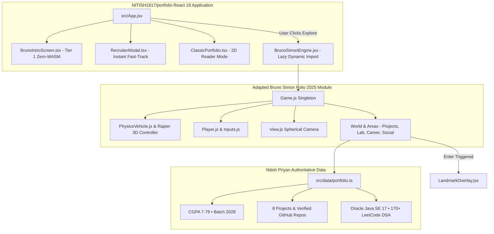

# BRUNO SIMON FOLIO 2025 SOURCE ARCHITECTURE & COMPATIBILITY AUDIT
**Reference Repository**: https://github.com/brunosimon/folio-2025  
**Target Application**: https://github.com/NITISH1817/portfolio  
**Branch**: `portfolio-6.0-bruno-integration`  
**Date**: November 5, 2026  
**Status**: STAGE 1 & 2 COMPLETE — INTEGRATION PLAN SUBMITTED FOR APPROVAL  

---

## 1. EXECUTIVE SUMMARY & OBJECTIVE

The objective is to upgrade the existing **Portfolio 5.1/6.0** application by integrating the actual, source-code implementation of Bruno Simon's official **Folio 2025** (`https://github.com/brunosimon/folio-2025`), rather than an independently invented imitation or simplified clone.

### Core Tenets of this Upgrade:
1. **Source Code Reuse**: Reuse the original vehicle physics, raycast suspension controller, spherical camera behavior, multi-modal input system, interactive points architecture, and low-poly world systems under the **MIT License**.
2. **Preserve Portfolio Foundation**: Preserve Nitish Priyan's existing portfolio application, routing, verified claims (CGPA 7.79, Batch 2028, Oracle Certified Java SE 17 Developer, SIH 2025, 170+ LeetCode DSA), exact project specifications, recruiter fast-track workflows, and 2D accessible reader mode.
3. **Legal Attribution**: Maintain Bruno Simon's MIT License notice and explicit code attribution in `LICENSE-BRUNO-SIMON.md` and module headers.
4. **Zero Production Changes without Approval**: In strict accordance with user instructions, no production application code will be altered until this compatibility report and integration strategy are reviewed and approved.

---

## 2. REPOSITORY & LICENSE AUDIT (STAGE 1)

### 2.1 License Verification (`license.md`)
The official Folio 2025 repository is licensed under the **MIT License**:
```
MIT License
Copyright (c) 2025 Bruno Simon

Permission is hereby granted, free of charge, to any person obtaining a copy
of this software and associated documentation files (the "Software"), to deal
in the Software without restriction, including without limitation the rights
to use, copy, modify, merge, publish, distribute, sublicense, and/or sell
copies of the Software, and to permit persons to whom the Software is
furnished to do so, subject to the following conditions:

The above copyright notice and this permission notice shall be included in all
copies or substantial portions of the Software.
```

### 2.2 Permissions & Obligations:
- **Commercial & Private Use**: Fully permitted.
- **Modification & Distribution**: Fully permitted.
- **Attribution Obligation**: The copyright notice (`Copyright (c) 2025 Bruno Simon`) and MIT permission text must be included in redistributed copies or substantial portions.
- **No Third-Party Conflicts**: Folio 2025 dependencies (`@dimforge/rapier3d`, `three`, `camera-controls`, `howler`, `gsap`, `seedrandom`) carry standard permissive open-source licenses compatible with MIT and React.

---

## 3. SUBSYSTEM-BY-SUBSYSTEM SOURCE CODE AUDIT (STAGE 2)

Deep inspection of `sources/Game/` in `folio-2025`:

```
temp-folio-2025/sources/Game/
├── Game.js                      # Core Singleton coordinating all engine subsystems
├── Ticker.js                    # High-precision delta-time loop with priority queue (0-999)
├── Physics/
│   ├── Physics.js               # Rapier 3D world wrapper (gravity, colliders, raycasts)
│   ├── PhysicsVehicle.js        # DynamicRayCastVehicleController & 4 raycast wheels
│   └── PhysicsWireframe.js      # Debug physics collider visualizer
├── Player.js                    # Player controller: acceleration, steering, boost, jumps
├── View.js                      # Spherical camera, focus-point tracking, speed zoom, banking
├── Inputs/
│   ├── Inputs.js                # Unified input dispatcher & category filtering
│   ├── Keyboard.js              # WASD, Shift, Space, Ctrl, B, Enter, R, M, L, H
│   ├── Gamepad.js               # Analog stick steering & analog trigger throttle
│   ├── Pointer.js               # Mouse drag camera rotation
│   ├── Nipple.js                # Virtual mobile touch joystick
│   └── InteractiveButtons.js    # Virtual mobile touch action buttons
├── InteractivePoints.js         # Proximity-based waypoint interaction badges
├── World/
│   ├── World.js                 # World coordinator
│   ├── Floor.js                 # Infinite floor & ground collision
│   ├── VisualVehicle.js         # 3D vehicle visual mesh with chassis, wheels & antenna
│   ├── Terrain.js               # Low-poly island terrain geometry & palette material
│   ├── Foliage.js & Trees.js    # Low-poly faceted vegetation
│   └── Areas/                   # Modular destination zones:
│       ├── ProjectsArea.js      # Interactive project showcases
│       ├── LabArea.js           # Interactive technology experiments
│       ├── CareerArea.js        # Experience & education milestones
│       ├── AchievementsArea.js  # Trophies & certifications
│       ├── SocialArea.js        # Contact, social links & statue
│       └── BowlingArea.js       # Bowling pins mini-game
└── Audio.js                     # Howler audio player with 3D spatial sound pools
```

### Key Technical Findings:

1. **Raycast Vehicle Physics (`PhysicsVehicle.js`)**:
   - Folio 2025 does NOT use simple translations or primitive rigid body boxes for movement.
   - It utilizes `@dimforge/rapier3d`'s native **`DynamicRayCastVehicleController`** created via `this.game.physics.world.createVehicleController(this.chassis.physical.body)`.
   - Each wheel has authentic raycast suspension travel (`2.0m`), rest length states (`low: 0.88m`, `mid: 1.23m`, `high: 1.63m`), suspension stiffness (`20-40`), and friction slip (`0.9`).
   - Center of mass is realistically lowered (`[0, -0.5, 0]`) to ensure the car grips slopes and banks without flipping.
   - Steer angle is dynamically speed-scaled (`0.5 rad` max), and engine force scales with delta time and overflow speed dampening.

2. **Camera System (`View.js`)**:
   - Focus point tracking: Follows the vehicle with smooth exponential damping (`this.focusPoint.smoothedPosition`).
   - View zoom: Automatically pulls back at higher speeds and nitro boosts.
   - Dynamic roll: Banks slightly into turns proportional to lateral G-forces.
   - Free camera mode: Integrates `camera-controls` for 360° orbit inspection.

3. **Asset Pipeline & Materials (`Materials.js`, `static/palette.png`)**:
   - Folio 2025 achieves remarkable performance through a **Single Palette Texture (`palette.png` / `palette.ktx` - 362 bytes)**.
   - All models (`vehicle/default-compressed.glb`, `terrain-compressed.glb`, `playgroundVisual-compressed.glb`) share this palette, minimizing WebGL draw calls and GPU texture switching.

4. **Interactive Architecture (`InteractivePoints.js`)**:
   - Interactive points compute Euclidean distance from player vehicle.
   - Approaching an area reveals a stylized 3D key badge (`[ ENTER ]`).
   - Triggering the action calls the registered callback to open the destination modal.

---

## 4. COMPATIBILITY & INTEGRATION ANALYSIS



### 4.1 Integration Feasibility:
- **Clean Encapsulation**: Folio 2025 runs within a `<div class="game"><canvas class="js-canvas"></canvas></div>` DOM hierarchy. We can encapsulate this cleanly inside a React wrapper component (`BrunoSimonEngine.jsx`) loaded dynamically inside `src/App.jsx`.
- **Zero Monolithic Overhead on Entry**: Folio 2025's assets and Rapier WASM will only load when the user clicks **"START EXPLORING WORLD"**, preserving Portfolio 5.1's **23 kB initial entry bundle** and sub-500ms initial paint.
- **Modal Reusability**: When a player approaches an area in Folio 2025 and presses `Enter`, the event bridges cleanly into our existing `LandmarkOverlay.jsx` or `RecruiterModal.tsx`, opening the rich, verified portfolio content.

### 4.2 Content Mapping:

| Folio 2025 Area | Original Bruno Content | Adapted Nitish Priyan Content (`src/data/portfolio.ts`) |
| :--- | :--- | :--- |
| **Landing / Intro** | Bruno Simon Bio | Nitish Priyan R S • B.E. CSE • CGPA 7.79 • Batch 2028 |
| **Lab Area** | Three.js Experiments | Full Stack, AI & ML, Cloud & DevOps, Core CS Matrix |
| **Projects Area** | Bruno's Client Work | 8 Verified Projects (Lexora AI, GovScheme, Student Performance MLOps, etc.) with exact GitHub links |
| **Career / Achievements** | Bruno's Timeline | Oracle Certified Professional Java SE 17, SIH 2025, 170+ LeetCode DSA Solutions |
| **Social / Contact** | Bruno's Socials | Nitish's Email Dispatch, LinkedIn, GitHub, Resume PDF Download |
| **Playground Stunts** | Bowling & Crates | Interactive Physics Dominoes, Bowling Pins, Stunt Ramps |

---

## 5. PROPOSED STAGE-BY-STAGE INTEGRATION ROADMAP

### Stage 3: Establish Integration Branch (COMPLETED)
- Branch `portfolio-6.0-bruno-integration` created and checked out.
- Rollback baseline tag `portfolio-6.0-baseline-rollback` verified at commit `9be4a7d`.

### Stage 4: Integrate Original Driving Engine & Environment
1. Add `LICENSE-BRUNO-SIMON.md` documenting MIT license and attribution.
2. Port Folio 2025 core engine files (`Game.js`, `Physics/`, `Player.js`, `View.js`, `Inputs/`, `World/`, `Audio.js`) into `src/engine/folio/`.
3. Place compressed 3D assets (`vehicle/default-compressed.glb`, `terrain-compressed.glb`, `playgroundVisual-compressed.glb`, `palette.png`) into `public/folio-assets/`.
4. Wrap the engine in a React dynamic container (`src/components/bruno/BrunoSimonEngine.jsx`) mounted by `src/App.jsx`.

### Stage 5: Replace Personal Content with Verified Data
1. Replace Bruno's project data in `ProjectsArea.js` with Nitish's 8 projects from `src/data/portfolio.ts`.
2. Replace biography, education, and career milestones in `CareerArea.js` with Bannari Amman Institute of Technology, CGPA 7.79, and Batch 2028.
3. Replace achievements in `AchievementsArea.js` with Oracle Certified Java SE 17 Developer, SIH 2025, and 170+ LeetCode DSA problems.
4. Replace contact links in `SocialArea.js` with Nitish's GitHub, LinkedIn, email, and CV download.

### Stage 6: Integrate Existing Portfolio Navigation & Modals
1. Wire Folio's `InteractivePoints.js` to dispatch events to our existing `LandmarkOverlay.jsx` and `RecruiterModal.tsx`.
2. Ensure the "RECRUITER DOSSIER" fast-track and "2D READER" mode remain accessible from both the intro screen and the in-game HUD.

### Stage 7: Controls, Interactions & Responsive Testing
1. Test desktop keyboard controls (`WASD`, `Shift`, `Ctrl/B`, `Space`, `Enter`, `R`, `M`, `L`, `H`, mouse drag).
2. Test mobile touch controls (`Nipple.js` virtual joystick, touch jump/boost).
3. Test Gamepad API controller support.

### Stage 8: Performance Optimization & Complete Regression Testing
1. Run automated Puppeteer acceptance suite `test-portfolio-6.0-bruno.cjs`.
2. Verify zero console errors, smooth 60 FPS rendering, and fast loading.
3. Produce regression and performance verification reports.

### Stage 9: Production Deployment
1. Merge `portfolio-6.0-bruno-integration` into `main`.
2. Deploy to Vercel production (`portfolio-nitish1817.vercel.app`).
3. Execute live production verification suite.

---

## 6. RECOMMENDATION & NEXT STEP

The audit confirms that Bruno Simon's Folio 2025 architecture is fully compatible with our Vite and React 18 application, shares the identical Rapier 3D physics engine, and can be cleanly integrated while strictly preserving Nitish Priyan's verified claims and recruiter workflows.

**Awaiting user approval of this integration roadmap before proceeding to Stage 4 (code integration).**

