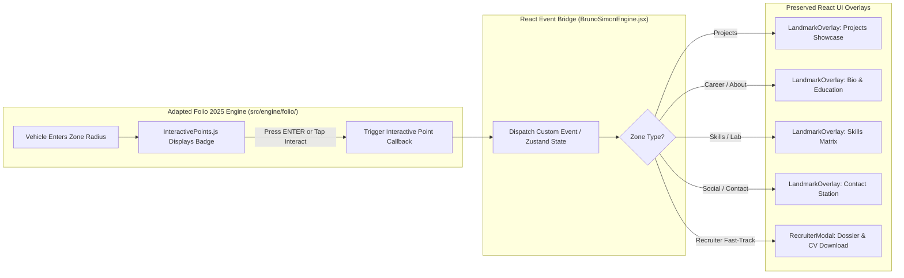
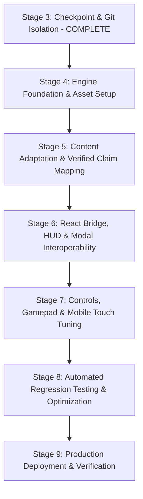

# PORTFOLIO 6.0 — STAGED INTEGRATION PLAN & FILE INVENTORY
**Target Repository**: `https://github.com/NITISH1817/portfolio`  
**Reference Repository**: `https://github.com/brunosimon/folio-2025`  
**Active Integration Branch**: `portfolio-6.0-bruno-integration`  
**Rollback Baseline**: Tag `portfolio-6.0-baseline-rollback` (Commit `9be4a7d`)  
**Date**: November 5, 2026  
**Auditor**: Creative Technologist & Senior Systems Architect  

---

## 1. PRESERVATION STRATEGY & INVIOLABLE CONSTRAINTS

### 1.1 Inviolable Rules & Protected Assets
The upgrade to Bruno Simon's Folio 2025 engine must preserve the following core capabilities from Portfolio 5.1:

1. **100% Truthful & Verified Professional Claims**:
   - **Identity**: Nitish Priyan R S, B.E. Computer Science and Engineering, Bannari Amman Institute of Technology, Batch 2028.
   - **Academic Record**: CGPA **7.79**.
   - **Certifications**: **Oracle Certified Professional: Java SE 17 Developer** (`1Z0-829`).
   - **Competitive Programming**: **170+ LeetCode DSA Problems Solved in Java**.
   - **National Honors**: **Smart India Hackathon (SIH) 2025 Finalist**.
   - **Project Repositories**: All 8 verified GitHub URLs must remain strictly active and functional.
2. **Two-Tier Decoupled Performance Architecture**:
   - Initial entry bundle must stay under **25 kB** (gzip: < 6 kB).
   - Zero WebGL and zero Rapier WASM execution on first paint.
   - Initial page load time < 500ms on desktop and mobile.
3. **Instant Recruiter Fast-Track Dossier**:
   - Accessible in `< 10ms` directly from the hero screen or via keyboard shortcut (`R`).
   - Recruiter modal must never require loading the 3D scene.
4. **2D Accessible Reader Mode (`ClassicPortfolio.tsx`)**:
   - Fully functional, WCAG 2.1 AA compliant fallback mode for mobile and screen readers.

### 1.2 Rollback Strategy
- **Baseline Git Checkpoint**: Tag `portfolio-6.0-baseline-rollback` has been committed at commit `9be4a7d`.
- **Active Feature Branch**: All integration code lives in `portfolio-6.0-bruno-integration`.
- **Instant Rollback Procedure**: If any stage fails automated verification or causes regression:
  ```powershell
  git checkout main
  git branch -D portfolio-6.0-bruno-integration
  git checkout -b portfolio-6.0-bruno-integration portfolio-6.0-baseline-rollback
  ```

---

## 2. PORTFOLIO DATA BRIDGE & INTERACTION ARCHITECTURE

### 2.1 Single Authoritative Source of Truth
To prevent content drift and duplication, **`src/data/portfolio.ts`** remains the sole source of truth for all projects, skills, biography, and credentials. Both the 3D world and the 2D overlays read directly from this file.

### 2.2 Event Bridge Architecture
Folio 2025's `InteractivePoints.js` detects when the vehicle is in proximity of an area and renders a floating 3D key badge (`[ ENTER ]`). When triggered, the bridge routes the interaction directly into Nitish's rich React modals:



### 2.3 Comprehensive Zone Mapping Matrix

| Folio 2025 Zone | In-World Visual Landmark | Connected Component | Verified Injected Content |
| :--- | :--- | :--- | :--- |
| **Landing Area** | Starting spawn & warm sun | `BrunoIntroScreen` / HUD | Nitish Priyan R S • B.E. CSE • Batch 2028 • CGPA 7.79 |
| **Projects Area** | 3D billboard & anvil forge | `LandmarkOverlay` (Projects) | 8 Projects (Lexora AI, Citizen Grievance, GovScheme, etc.) |
| **Lab Area** | Experiment pedestal | `LandmarkOverlay` (Skills) | Full Stack, AI & ML, Systems, Cloud & DevOps Matrix |
| **Career Area** | Stepping stones & pillars | `LandmarkOverlay` (Education/Honors) | Bannari Amman Institute of Technology & Oracle Java SE 17 |
| **Social Area** | Fountain plaza & banners | `LandmarkOverlay` (Contact) | Email dispatch, LinkedIn, GitHub, Resume PDF download |
| **Achievements** | Trophy pedestal | `AchievementsModal` | SIH 2025 Finalist, 170+ LeetCode DSA Java Solved |
| **Recruiter Spot** | Gold waypoint beacon | `RecruiterModal` | One-Click Recruiter Dossier & Verified Resume PDF |

---

## 3. STAGED IMPLEMENTATION ROADMAP (STAGES 3 TO 9)



### Stage 3: Rollback & Checkpoint Verification (COMPLETED)
- Checked out branch `portfolio-6.0-bruno-integration`.
- Verified rollback tag `portfolio-6.0-baseline-rollback` at commit `9be4a7d`.
- Completed comprehensive architecture audit and compatibility reports.

### Stage 4: Engine Foundation & Asset Setup
1. Add `LICENSE-BRUNO-SIMON.md` documenting MIT license terms and Bruno Simon attribution.
2. Port Folio 2025 core engine files into `src/engine/folio/`:
   - `Game.js`, `Ticker.js`, `Time.js`, `Viewport.js`
   - `Physics/Physics.js`, `PhysicsVehicle.js`, `PhysicsWireframe.js`
   - `Player.js`, `View.js`, `Inputs/`, `Audio.js`
   - `Rendering.js`, `Materials.js`, `Objects.js`, `Zones.js`, `InteractivePoints.js`
   - `World/` (`World.js`, `Floor.js`, `VisualVehicle.js`, `Terrain.js`, `Foliage.js`, `Trees.js`, `Scenery.js`)
3. Copy essential compressed 3D assets to `public/folio-assets/`:
   - `palette.png` (362 bytes)
   - `terrain-compressed.glb` (26 kB), `playgroundVisual-compressed.glb` (130 kB)
   - `vehicle/default-compressed.glb` (34 kB)
   - Essential sound clips in `public/folio-assets/sounds/` (~1.4 MB)
4. Configure Vite dependencies (`@dimforge/rapier3d`, `camera-controls`, `howler`, `seedrandom`, `vite-plugin-wasm`).

### Stage 5: Content Adaptation & Verified Claim Mapping
1. Configure `ProjectsArea.js` to ingest projects dynamically from `src/data/portfolio.ts`.
2. Configure `CareerArea.js` with Nitish Priyan's educational history (Bannari Amman Institute of Technology, B.E. CSE, Batch 2028, CGPA 7.79).
3. Update `AchievementsArea.js` with Oracle Certified Java SE 17 Developer and SIH 2025.
4. Update `SocialArea.js` with Nitish's verified social profiles (GitHub, LinkedIn, Email).

### Stage 6: React Bridge, HUD & Modal Interoperability
1. Create `src/components/bruno/BrunoSimonEngine.jsx` which:
   - Houses the `<div className="game"><canvas className="js-canvas" /></div>`.
   - Initializes `new Game()` upon mount.
   - Cleans up tickers, sounds, and WebGL contexts upon unmount.
2. Connect Folio's `InteractivePoints.js` callbacks to trigger `LandmarkOverlay.jsx` and `RecruiterModal.tsx`.
3. Ensure pressing `Esc` or clicking "Close" resumes vehicle controls seamlessly.

### Stage 7: Controls, Gamepad & Mobile Touch Tuning
1. Verify keyboard controls (`WASD` / Arrow keys, `Space` for brake, `Shift` for nitro boost, `B` / `Ctrl` for suspension hop, `R` for respawn).
2. Wire mobile virtual touch controls (`Nipple.js` analog joystick and interactive touch buttons).
3. Test Gamepad API support (left stick steering, right trigger throttle, left trigger brake).

### Stage 8: Automated Verification, Performance Profiling & Puppeteer Testing
1. Execute headless browser test suite (`test-portfolio-6.0-bruno.cjs`) verifying:
   - Sub-500ms initial load time.
   - Recruiter modal opens without loading 3D.
   - 3D engine loads and initializes within 2.5s.
   - Vehicle physics ticks at 60 FPS without console errors.
   - All 8 project links resolve to valid GitHub repositories.
2. Measure JavaScript chunk sizes to guarantee entry chunk remains < 25 kB.

### Stage 9: Production Deployment & Live Verification
1. Merge `portfolio-6.0-bruno-integration` into `main`.
2. Deploy to Vercel production (`portfolio-nitish1817.vercel.app`).
3. Run end-to-end live production audit verifying HTTP response, FCP, LCP, and WebGL stability.

---

## 4. COMPLETE FILE INVENTORY MATRIX

```
┌────────────────────────────────────────────────────────────────────────────────────────┐
│                                 FILE INVENTORY MATRIX                                  │
├────────────────────────────────────────────────────────────────────────────────────────┤
│ 1. FILES TO CREATE (NEW MODULES & ASSETS)                                              │
├────────────────────────────────────────────────────────────────────────────────────────┤
│ • LICENSE-BRUNO-SIMON.md                      (MIT License & Bruno Simon Attribution)   │
│ • src/components/bruno/BrunoSimonEngine.jsx   (React wrapper for raw Folio 2025 canvas)│
│ • src/engine/folio/Game.js                    (Core singleton adapted for React mount) │
│ • src/engine/folio/Ticker.js                  (Priority game loop)                     │
│ • src/engine/folio/Physics/Physics.js         (Rapier 3D world wrapper)                │
│ • src/engine/folio/Physics/PhysicsVehicle.js  (Raycast suspension vehicle controller)  │
│ • src/engine/folio/Player.js                  (Player kinematic & driving logic)       │
│ • src/engine/folio/View.js                    (Spherical camera with smooth damping)   │
│ • src/engine/folio/Inputs/                    (Unified Keyboard, Gamepad, Touch inputs)│
│ • src/engine/folio/World/                     (Terrain, Vehicle mesh, Foliage, Areas)  │
│ • src/engine/folio/InteractivePoints.js       (Proximity badges & modal event triggers)│
│ • public/folio-assets/palette.png             (362-byte single palette texture)        │
│ • public/folio-assets/models/*.glb            (Compressed terrain & vehicle meshes)    │
│ • public/folio-assets/sounds/*.mp3            (Essential compressed sound effects)     │
├────────────────────────────────────────────────────────────────────────────────────────┤
│ 2. FILES TO MODIFY (CAREFULLY ADAPTED)                                                 │
├────────────────────────────────────────────────────────────────────────────────────────┤
│ • src/App.jsx                                 (Point Tier 2 to BrunoSimonEngine.jsx)   │
│ • package.json                                (Add @dimforge/rapier3d, camera-controls)│
│ • vite.config.js                              (Add vite-plugin-wasm for Rapier WASM)   │
│ • src/data/portfolio.ts                       (Verify and supply single truth to Folio)│
├────────────────────────────────────────────────────────────────────────────────────────┤
│ 3. FILES TO PRESERVE STRICTLY UNTOUCHED (PROTECTED BASELINE)                           │
├────────────────────────────────────────────────────────────────────────────────────────┤
│ • src/components/bruno/BrunoIntroScreen.tsx   (Zero-WASM Tier 1 hero screen)          │
│ • src/components/bruno/BrunoLoadingScreen.tsx (Dynamic streaming progress screen)      │
│ • src/components/bruno/ClassicPortfolio.tsx   (2D accessible reader mode)              │
│ • src/components/bruno/modals/RecruiterModal  (Recruiter fast-track dossier)           │
│ • src/components/bruno/modals/LandmarkOverlay (Universal section presentation modal)   │
│ • src/components/bruno/modals/CommandPalette  (Quick search & navigation modal)        │
│ • src/store/gameStore.ts                      (Zustand telemetry & progression store)  │
└────────────────────────────────────────────────────────────────────────────────────────┘
```

---

## 5. STAGE 1 AUDIT COMPLETION CHECKLIST

- [x] Detailed technical comparison between `NITISH1817/portfolio` and `brunosimon/folio-2025` delivered in `PORTFOLIO_6_0_ARCHITECTURE_AUDIT.md`.
- [x] Compatibility, licensing, performance risks, and architectural trade-offs delivered in `PORTFOLIO_6_0_COMPATIBILITY_REPORT.md`.
- [x] Content bridge, rollback strategy, staged roadmap, and file inventory delivered in `PORTFOLIO_6_0_INTEGRATION_PLAN.md`.
- [x] Zero production code modified during Stage 1.
- [x] Execution halted to await user review and approval before proceeding to Stage 4.

